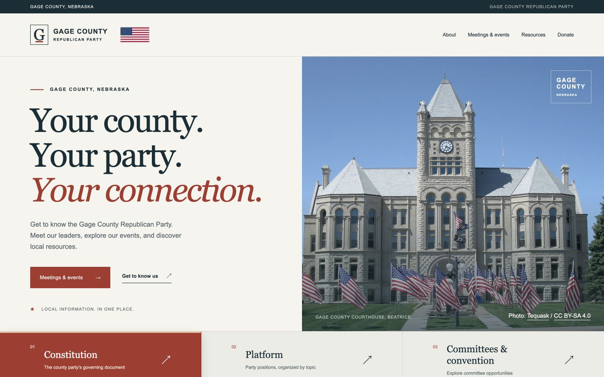
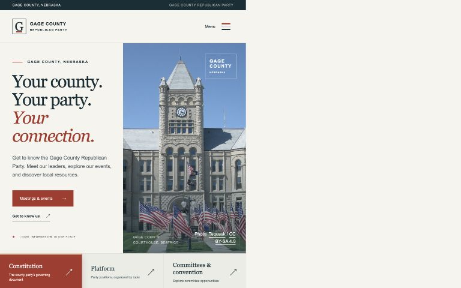
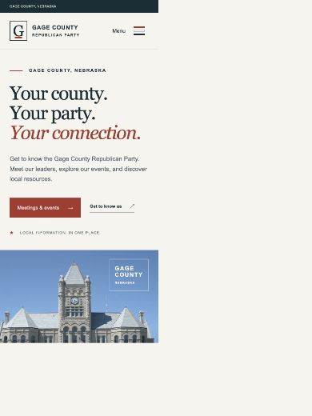

# Creative direction and user-experience review

**Reviewed:** November 20, 2026
**Status:** Review complete. Owner clarifications and proposed recommendations recorded below.
**Scope:** Read-only review of the current local preview. No changes to the design, copy, navigation, forms, assets, build, or deployment.

## Purpose and assumptions

Evaluate how the site serves the organization's stated goals: awareness, recruiting participation, attendance, committee involvement, and maintaining useful private contact information. Evaluate the current experience independently of the rationale behind earlier design choices.

The future committees page is assumed to contain approximately eight genuine opportunities and ways to participate. Its current placeholder is not scored as a deficiency. No committee names, participation requirements, workload, or availability have been invented.

This is an expert heuristic review, supported by browser inspection and measurements. It is not a study of actual visitor behavior, a conversion experiment, or a complete accessibility audit. No analytics or user research were available. Statements about likely confusion or motivation are hypotheses, distinguished from observed interface behavior.

## Overall assessment

The visual language is coherent and recognizable: local photography, warm paper, dark ink, serif headings, and restrained red. The site communicates place and institutional seriousness well. Common headers, functional direct links, readable text, and a modest number of main navigation items support basic orientation.

The larger issue is the hierarchy of tasks. The interface currently gives strong early emphasis to governing documents and civic reference, while participation, meeting specifics, and contact capture receive less visibility. It is easier to understand that the party has information than to understand what an interested newcomer can do next. This diagnosis does not require abandoning the visual system.

There is a difference between getting lost and failing to find a compelling next action. Most tested destinations can be reached and understood. Participation routes are less explicit, and the same committee terminology leads to different kinds of information.

## Audiences considered by task

| Visitor intent | Current experience observed |
| --- | --- |
| Curious first-time visitor | Local identity is immediate. The opening promise emphasizes learning about leaders, events, and resources. A specific invitation to participate is not present in the hero. |
| Person considering attending | A prominent Meetings & events link is visible in the first phone screen. The actual date, time, and venue are below the initial homepage viewport. The destination page shows the next meeting clearly but does not describe the newcomer experience. |
| Potential volunteer or committee participant | Card 03 is the direct homepage route. It is absent from the main navigation. Some participation-related links lead to governance rather than the opportunities page. |
| Existing participant updating details | No contact-update or preference-management path currently exists. |
| Person seeking party rules or policy | Constitution and Platform have direct homepage access, readable HTML, and topic/article links. Desktop current-section underlines help orientation. |
| Resident seeking a county official | The homepage government bar and footer provide entry. The guide provides jump links and current contacts; its explanatory material and maps make it lengthy on mobile. |
| Potential donor | Donate is persistently available in the global navigation and has a major homepage section. This review did not verify recipient identity or complete a payment. |

These are task-based audiences, not demographic segments. No assumptions about age, device ownership, party registration, technical ability, or eligibility are treated as established facts.

## Homepage visibility measurements

Positions are CSS pixels from the document top at initial scroll position. A card's top becoming visible is not the same as its date and venue being readable. Browser text rendering, height, and zoom can change these measurements.

| Viewport | Homepage meeting card starts | Card 03 starts | What is visible initially |
| --- | ---: | ---: | --- |
| Desktop 1440 × 900 | 1,029px | 790px | Hero and most of the document/committee strip; no meeting specifics. |
| Landscape tablet 1024 × 768 | 902px | 706px | Hero and start of quick-access strip; no meeting specifics. |
| Portrait tablet 768 × 1024 | 964px | 792px | Hero, strip, and only the beginning of the meeting card near the screen bottom. |
| Phone 390 × 844 | 1,639px | 1,191px | Hero copy, Meetings & events button at about 487px, and part of the courthouse photo; no quick-access cards or meeting specifics. |

At 390px the photo alone occupies 380px. The quick-access strip stacks into three cards before the introductory copy and meeting card. The donation section occupies about 852px, and the photo section about 1,376px. The final contact call to action begins around 4,605px. The page did not overflow horizontally at the four reviewed widths.

The evidence supports the concern about the homepage meeting notice being below the fold. It does not prove that visitors miss meetings: there is a clear above-fold meeting link. Whether an additional top notice is the best solution is reserved for the recommendation phase, alongside the overall content order.

## Observed friction and goal alignment

| Finding | Evidence | Likely effect / interpretation |
| --- | --- | --- |
| Action priority and visual priority differ | Constitution is the red, shadowed first quick-access card. Committee participation is the third, unfeatured card. | The strongest treatment signals that reading rules is the main next step, even though recruitment and participation are stated goals. |
| The first screen is welcoming in tone but nonspecific about participation | “Your county. Your party. Your connection.” and the introductory paragraph invite exploration of information. | A newcomer must infer the value and practical meaning of involvement. The local tone works; the actionable promise is less developed. |
| Meeting specifics are separated from the first invitation | The hero's link opens Events. Date and venue are in a later homepage card. | A visitor cannot assess the immediate opportunity to attend from the opening screen alone. |
| Two destinations share essentially the same title | committees.html is titled “Committees & convention”; resources.html#organization also says “Committees & convention.” | Opportunity discovery and formal governance can appear interchangeable. This remains an issue even after the future committee content is supplied. |
| A participation path leads to governance | Contact → “Learn how the committee works” opens Resources organization disclosures. About → “County committee” does the same. | People asking how to help encounter institutional structure, not the future list of work they could take on. |
| Primary navigation omits participation | Desktop contains About, Meetings & events, Resources, Donate; mobile adds Home. | A visitor who entered on an interior page has no global direct route to the opportunities page. Contact is in the footer and contextual links. |
| Contact requires an external handoff | The email address opens a mailto link; Facebook and Instagram leave the site. | There is no on-site mechanism to express interest, subscribe, update details, or receive an acknowledgment. A mailto link requires an available mail workflow. |
| Contact capture and membership are not defined as separate tasks | The existing site has no signup. The constitution describes membership in terms of registered Republican voters who desire to support party objectives. | “Join,” “register,” “subscribe,” and “update” cannot safely be treated as synonyms when planning a new intake path. The owner's intended scope is unresolved. |
| Donation has more presence than a participation handoff | Donate is a global item and a large dark homepage band. No equivalent persistent involvement or updates action exists. | The design gives an established support action greater visibility than the stated recruitment and contact goals. This is a hierarchy observation, not an argument against donations. |
| Social proof appears after the donation section | Community photos are lower on the homepage. All three photo-story links open the same gallery anchor. | Evidence of real people and activities arrives late. Different story labels do not lead to distinct stories or filtered collections. |
| Resources leads with the previous election's reference material | The first two cards are 2026 voter card and Party Reveal. They are not labeled as a completed election cycle. | A general Resources visitor first encounters an election-oriented hierarchy after the user has identified that election as over. |
| Current navigation state covers exact pages only | About, Events and Resources underline on their own pages. Constitution, Platform, Committees, Contact and Government have no selected main-navigation parent. | Interior pages remain named, but a reader gets less help understanding where each belongs in the overall site. |
| Long pages have substantial navigation distance on phones | Main header is not persistent. Platform has 20 small jump links before its text; its text begins about 775px down on a 390px phone. The government guide is more than 13,000px long at that width. | Direct jump links help specific tasks. Moving to another section or another site task later in a long page requires more effort. Length is not itself a defect when the information is necessary. |
| The Events page combines attendance information and a historical gallery | The introductory sentence mentions a “photographic record.” No first-visit explanation, street address/directions, RSVP instruction, or attendance eligibility statement is present. | The date is findable, but practical and social questions a newcomer may have remain unanswered. The correct answers require owner confirmation. |
| Calendar-series explanation is inconsistent | Homepage explains the monthly second-Tuesday schedule directly above Add All. Events and Contact display Add All without equivalent adjacent explanation. | The meaning of the recurring import is clearest only on one of its entry points. |

## Color, typography, and responsive composition

### Strengths

The warm background and dark text support a calm reading experience. Red establishes party identity without covering every surface. Photographs supply local specificity and evidence of activity. The full-height responsive maps, explicit selection text, outlines, and numbered markers provide multiple cues rather than color alone. The desktop document underline is useful and does not need to be duplicated on a narrow layout merely for consistency.

### Findings

- The issue with red is its assigned meaning more than its hue. It currently marks action buttons, the featured constitution card, italic hero emphasis, map selection, and miscellaneous rules. The constitution feature has more depth and visual emphasis than the committee opportunity card.
- The dark donation band is a major visual stop. On a phone it is also a long section. This changes the relative prominence of giving money and taking part.
- The courthouse strongly communicates locality and civic seriousness. A newcomer could initially read the combination of courthouse, flag, monogram, and government guide as an institutional civic site; the Republican wordmark is present, but the recruitment purpose is less explicit. This is an impression to test, not an observed user misunderstanding.
- At 768px the hero remains two columns. “Your connection” wraps into separate lines and the courthouse becomes a narrow tower crop; the photo credit is also compressed. It is a functional layout but has a less deliberate composition than desktop or phone.
- At 1024px the desktop header links render at 11px. At 390px the platform topic links render at 11px and fill a 201px navigation block. Small navigation and labels add reading effort even when their colors contrast well.
- Large page-title areas give reference pages an editorial rhythm but postpone their useful content. At 390px the first constitution article starts about 749px down. This differs from the needs of someone arriving with a specific reference question.
- Subtle boundary rules are visually restrained. Their low contrast is not automatically a failure when decorative; the role and accompanying cues matter.

### Solid-color contrast checks

Calculated from the actual CSS tokens using relative luminance:

| Pair | Ratio |
| --- | ---: |
| Ink / paper | 13.11:1 |
| Muted text / paper | 5.69:1 |
| Red / paper | 5.79:1 |
| Warm white / red | 6.26:1 |
| Muted text / soft background | 5.24:1 |
| Divider line / paper | 1.31:1 |

The sampled text pairs exceed the 4.5:1 minimum described in [W3C's explanation of text contrast](https://www.w3.org/WAI/WCAG22/Understanding/contrast-minimum.html). This is not a site-wide accessibility certification: photo overlays, opacity, hover states, focus, target spacing, zoom, and assistive technology require separate evaluation. Strong contrast does not make 11px text comfortable for everyone.

## Contact-intake capability research

The owner's desired private collection is a new capability, not a present feature. No Google file, form, permissions, contact records, or communications system was created or inspected.

Official Google documentation establishes that Forms can send responses to a linked Sheet, allow response editing, and send response receipts. Enabling the form's results-summary setting can expose full-text responses or charts to respondents. A one-response restriction requires a Google sign-in. These are relevant implementation constraints for the future proposal, not a proposed configuration or an assurance that any existing account is private.

References checked during the review:

- [Choose where to save form responses](https://support.google.com/docs/answer/2917686)
- [Publish and share a form with responders](https://support.google.com/docs/answer/2839588)
- [View and manage form responses](https://support.google.com/docs/answer/139706)

## Owner clarifications and recommendations

After the review, the owner confirmed:

1. Newcomers may attend regular meetings without an invitation, RSVP, or existing membership.
2. The contact list serves both interested people and existing participants. “Already registered” means the organization already has contact information for them, not voter registration.
3. Access belongs to the executive team or an appointed committee member, in a private Google-held record. Current email/text notices are manual, rare, and important, including meeting cancellations or changes. A PWA is a future feature outside this scope.

The earlier findings about unclear intake purpose and attendance requirements describe the initial review state; these answers resolve them for the proposal. The complete [creative direction recommendations](CREATIVE-DIRECTION-RECOMMENDATIONS-2026-11-20.md) now cover navigation, homepage order, meeting visibility, opportunities, responsive treatment, and add/update contact intake. They remain proposals only. No implementation was authorized or performed.

## Evidence and change boundary

Browser review covered Home, About, Events, Contact, Resources and its disclosures, Committees, Platform, Constitution, and the Government guide. Source inspection also covered the shared layout, content model, and endorsement route. The voter card's imported application, source PDFs, external social accounts, donation recipient/payment completion, private member records, and email/text delivery were not audited end-to-end.

Four principal viewport sizes were checked: 1440 × 900, 1024 × 768, 768 × 1024, and 390 × 844. Measurements are in [evidence.json](review/creative-direction-2026-11-20/evidence.json). Current-site screenshots accompany those notes. The source-file checksum comparison is used to verify that the review itself did not change the implementation. Existing uncommitted design work remains untouched.

Final verification: all 19 snapshotted source files retained their checksums. Only review notes, measurement evidence, and read-only screenshots were added. The temporary viewport override was reset and the browser returned to the homepage. No build, commit, deployment, form creation, or contact-data access occurred.

### Current homepage evidence

Desktop:

Portrait tablet:

Phone:

